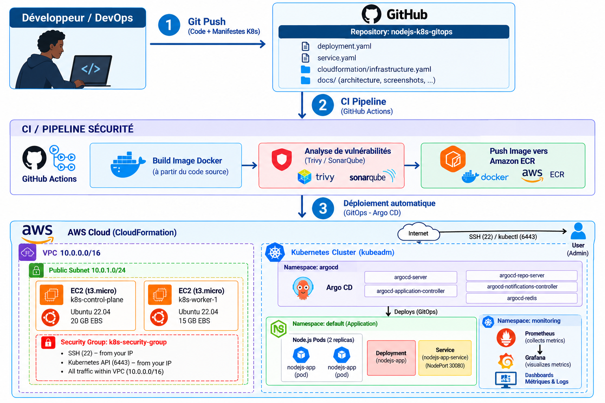
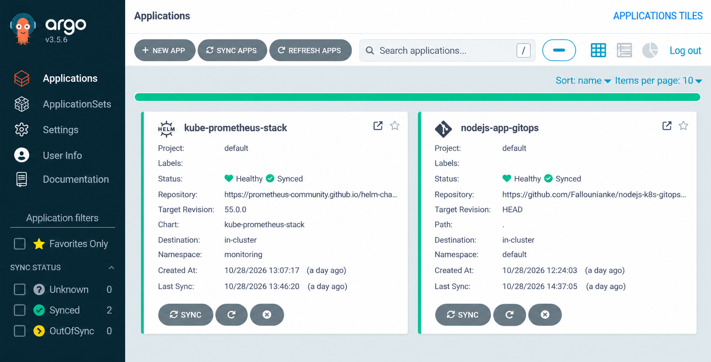
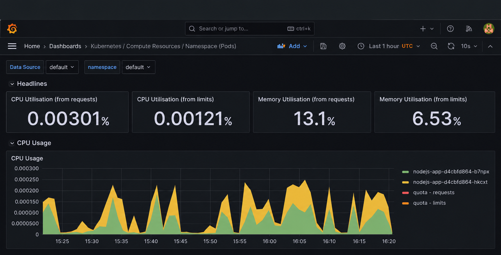
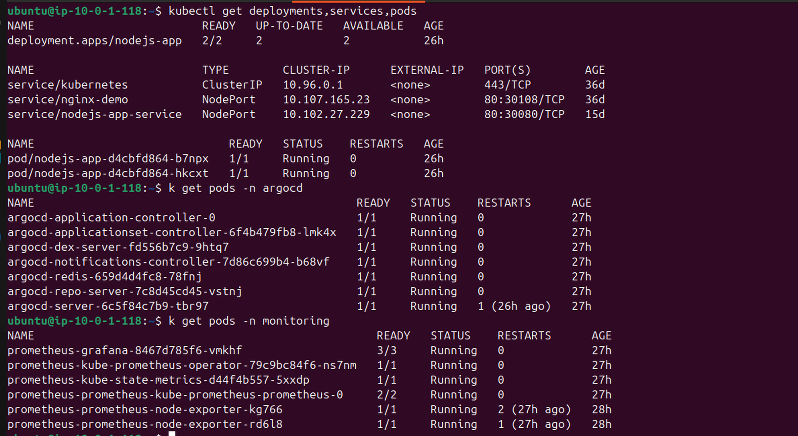

# 🚀 CINERANK — Kubernetes GitOps sur AWS

## 📌 Présentation

Ce projet personnel consiste à déployer, exposer et superviser une application **Node.js sur un cluster Kubernetes monté à la main sur AWS**, en suivant une approche **DevSecOps et GitOps**.

L'application support, **CINERANK**, présente le classement des 100 meilleurs films d'Hollywood. Elle est accessible en HTTPS sur **https://sentinel-monitoring.fr**.

L'objectif est de monter en compétences sur Kubernetes en le pratiquant de bout en bout :
- **Construire** : monter et administrer son propre cluster ;
- **Automatiser** : scanner, construire et déployer chaque changement sans intervention manuelle sur le cluster ;
- **Exploiter** : exposer l'application en HTTPS, l'adapter à la charge et la superviser.

## 🏗️ Architecture



Le projet repose sur **deux dépôts** :

| Dépôt | Contenu |
|---|---|
| `projet-Devsecops` | Code de l'application Node.js, Dockerfile, pipeline CI (GitHub Actions) |
| `nodejs-k8s-gitops` (ce dépôt) | Manifestes Kubernetes et template CloudFormation, surveillés par Argo CD |

## 🛠️ Technologies utilisées

| Technologie | Rôle |
|---|---|
| AWS CloudFormation | Provisionnement de l'infrastructure (Infrastructure as Code) |
| AWS EC2 / VPC | Hébergement et réseau |
| Kubernetes (kubeadm) + Calico | Orchestration des conteneurs et réseau des pods |
| GitHub Actions | Intégration continue (scan, build, push) |
| Trivy | Scan de sécurité du code et des dépendances |
| Docker + Amazon ECR | Construction et stockage des images |
| Argo CD | Déploiement continu GitOps |
| Helm | Installation des composants du cluster |
| Ingress NGINX | Point d'entrée HTTP/HTTPS, routage par nom de domaine |
| cert-manager + Let's Encrypt | Certificats HTTPS automatiques |
| metrics-server + HPA | Autoscaling horizontal des pods |
| Prometheus | Collecte des métriques |
| Grafana | Visualisation et monitoring |

## ⚙️ Fonctionnement

**1. Infrastructure AWS**

CloudFormation provisionne un VPC (`10.0.0.0/16`), un subnet public, une Internet Gateway avec sa table de routage, un Security Group et deux instances EC2 Ubuntu 22.04 (Control Plane et Worker).

Le Security Group n'expose publiquement que les ports **80 et 443**. L'accès SSH et l'API Kubernetes (6443) sont réservés à l'administrateur, et le trafic est libre entre les nœuds du VPC.

**2. Pipeline CI / DevSecOps**

À chaque push sur le dépôt de l'application, GitHub Actions :
1. scanne le code et les dépendances avec **Trivy** (vulnérabilités `CRITICAL` et `HIGH`) ;
2. construit l'image Docker ;
3. pousse l'image sur **Amazon ECR**, taguée avec le **SHA du commit** pour assurer la traçabilité.

**3. Déploiement GitOps avec Argo CD**

Le nouveau tag d'image est mis à jour dans `deployment.yaml` de ce dépôt. Argo CD détecte le changement et synchronise le cluster.

La synchronisation automatique et le **self-heal** sont activés : toute modification manuelle dans le cluster est détectée et ramenée à l'état décrit dans Git, qui reste la seule source de vérité.

**4. Exposition en HTTPS**

Trois enregistrements DNS pointent vers le worker, où **Ingress NGINX** route selon le nom demandé :

| URL | Service |
|---|---|
| `https://sentinel-monitoring.fr` | Application CINERANK |
| `https://argocd.sentinel-monitoring.fr` | Interface Argo CD |
| `https://grafana.sentinel-monitoring.fr` | Dashboards Grafana |

Les certificats sont délivrés et renouvelés automatiquement par **cert-manager** via **Let's Encrypt**.

**5. Autoscaling**

Un **HorizontalPodAutoscaler** ajuste le nombre de pods selon la charge CPU :
- **2 pods minimum**, **4 maximum** ;
- seuil de **70 %** de la CPU demandée (`requests`) ;
- ajout et retrait progressifs (un pod à la fois), avec une fenêtre de stabilisation courte à la descente.

Le champ `replicas` est volontairement absent du Deployment : c'est le HPA qui gère le nombre de pods, ce qui évite un conflit avec Argo CD.

**6. Monitoring**

Prometheus collecte les métriques des nœuds, des pods et des objets Kubernetes. Grafana les affiche dans des dashboards (CPU et mémoire par namespace).

## 📸 Démonstration

### Argo CD — Application Healthy / Synced



### Grafana — Monitoring du cluster



### Kubernetes — État des ressources



## 📂 Structure du dépôt

```text
nodejs-k8s-gitops/
├── README.md
├── cloudformation/
│   └── infrastructure.yaml
├── deployment.yaml
├── service.yaml
├── hpa.yaml
└── docs/
    ├── architecture.png
    ├── argocd-tab.png
    ├── kubernetes-terminal.png
    └── tableau-grafana.png
```

## 🔮 Améliorations prévues

- Rendre le scan Trivy bloquant et ajouter un scan de l'image construite.
- Ajouter SonarQube pour l'analyse de la qualité du code.
- Ajouter des readiness et liveness probes.
- Mettre en place des NetworkPolicies entre les namespaces.
- Placer les nœuds dans un subnet privé.
- Remplacer les clés AWS statiques par un rôle IAM (ECR) et OIDC (GitHub Actions).
- Ajouter du stockage persistant pour Prometheus et Grafana, et des alertes (Alertmanager).
- Versionner dans ce dépôt l'ensemble des composants du cluster (Ingress, ClusterIssuer, charts Helm).

---

**Projet personnel — Cloud / DevSecOps / Kubernetes**

*Cheikh Fallou Wade*
