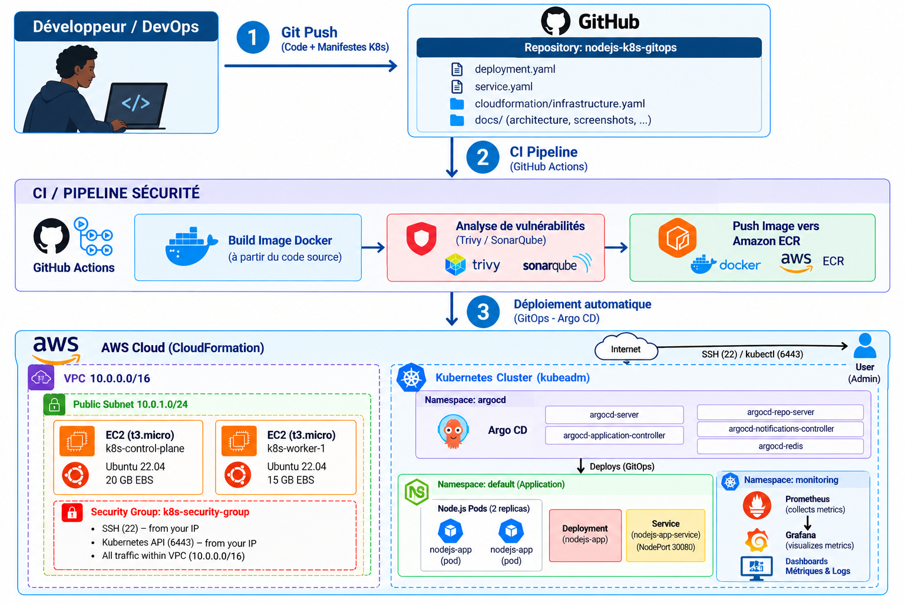

# 🚀 AWS Kubernetes GitOps — Déploiement d'une application Node.js

## 📌 Présentation

Ce projet personnel consiste à déployer et superviser une application **Node.js sur un cluster Kubernetes hébergé sur AWS**, en utilisant une approche GitOps.

L'objectif est de mettre en pratique les concepts de **Cloud Computing, Infrastructure as Code (IaC), Kubernetes, GitOps et Observabilité**.

## 🏗️ Architecture



### 🛠️ Technologies utilisées

| Technologie | Rôle |
|---|---|
| AWS CloudFormation | Provisionnement de l'infrastructure |
| AWS EC2 / VPC | Hébergement et réseau |
| Kubernetes (kubeadm) | Orchestration des conteneurs |
| Argo CD | Déploiement GitOps |
| Prometheus | Collecte des métriques |
| Grafana | Visualisation et monitoring |
| GitHub | Gestion des manifestes Kubernetes |

## ⚙️ Fonctionnement

**1. Infrastructure AWS**

CloudFormation provisionne un VPC (`10.0.0.0/16`), un subnet public et deux instances EC2 Ubuntu 22.04 (Control Plane et Worker).

**2. Déploiement Kubernetes**

L'application Node.js est déployée avec :
- Un `Deployment` configuré avec **2 réplicas**.
- Un `Service` de type **NodePort (30080)**.

**3. GitOps avec Argo CD**

Argo CD synchronise les manifestes Kubernetes stockés dans GitHub avec le cluster.

**4. Monitoring**

Prometheus collecte les métriques Kubernetes, visualisées dans Grafana.

## 📸 Démonstration

### Argo CD — Applications Healthy / Synced


### Grafana — Monitoring des Pods


### Kubernetes — État des ressources


## 📂 Structure du dépôt

```text
nodejs-k8s-gitops/
├── README.md
├── deployment.yaml
├── service.yaml
├── cloudformation/
│   └── infrastructure.yaml
└── docs/
    ├── architecture.png
    ├── argocd.png
    ├── grafana.png
    └── kubernetes.png
```

## 🔮 Améliorations prévues

- Ingress Controller et HTTPS.
- Horizontal Pod Autoscaler (HPA).
- Readiness et liveness probes.
- Renforcement de la sécurité Kubernetes.
- Amélioration de l'application Node.js.

---

**Projet personnel — Cloud / DevOps / Kubernetes**

*Cheikh Fallou Wade*
